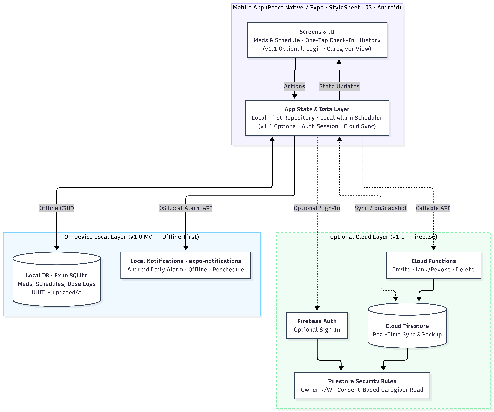

# medication-reminder

An Android mobile medication adherence app for patients and family caregivers, featuring local reminders, dose history logging, and optional consent-based real-time sharing.

> Not a medical device; intended as a medication reminder aid and does not provide medical advice.

**Status:** Designing & Planning (Local-First MVP) · **License:** [MIT](./LICENSE)

## Overview

Patients on daily medications often miss or delay doses, while remote family caregivers lack a clear, consent-based way to verify adherence. **medication-reminder** addresses this gap with a zero-friction, offline-first mobile app that starts without sign-up and optionally scales to real-time caregiver sharing.

## Core Features

### MVP (v1.0)
- **Medication & Schedule Setup:** Register medications, dosage, instructions, and daily reminder times offline.
- **One-Tap Check-In & History:** Log doses with one tap, edit intake time/notes, and review past logs.
- **Local Reminders:** Recurring on-device Android notifications via Expo Notifications.
- **Safety & Privacy Notice:** Non-medical disclaimer and local privacy consent on first launch.

### Post-MVP (v1.1)
- **Optional Sign-In & Backup:** Firebase Authentication for multi-device data sync.
- **Caregiver Sharing:** Invite-code linking/revoking with real-time read-only adherence view (Cloud Firestore).
- **Account Deletion:** In-app account and cloud data removal compliant with Google Play policies.

## Release Roadmap

| Phase | Milestone | Key Deliverables | Status |
| :--- | :--- | :--- | :--- |
| **Phase&nbsp;1** | **Design & Architecture** | PRD, user flows, wireframes, cloud-ready ERD (UUID & `updatedAt` schema), and sequence diagrams | In&nbsp;Progress 🏗️ |
| **Phase&nbsp;2** | **Local-First MVP Build** | Offline medication CRUD (Expo SQLite), one-tap logging, history, and Android local notifications verified via EAS Development Build | Planned |
| **Phase&nbsp;3** | **Android MVP Launch (v1.0)** | Notification/battery QA, Play Console compliance (Closed Testing, Health Apps Declaration, Privacy Policy URL), and Google Play release via EAS | Planned |
| **Phase&nbsp;4** | **Cloud & Caregiver Sync (v1.1)** | Optional Firebase Auth, Firestore real-time sync, Security Rules, and caregiver invite flow | Planned |

## Tech Stack

- **Mobile App:** React Native (Expo) / StyleSheet (JS) — Target: Android
- **Local Persistence & Notifications:** Expo SQLite, Expo-notifications (JS)
- **Optional Authentication:** Firebase Auth
- **Database & Real-Time Sync:** Cloud Firestore
- **Access Control:** Firestore Security Rules
- **Server Logic:** Cloud Functions for Firebase (invite codes, caregiver linking, account deletion)
- **Build & Release:** EAS Development Build, EAS Build (AAB), EAS Submit (Google Play Console)

## Architecture



## Documentation

Structured following the standard product engineering pipeline from problem definition to iterative implementation:

| Stage | Summary |
| :--- | :--- |
| **[1. PRD](./docs/01-prd.md)** | Problem statement, user stories, acceptance criteria, MVP vs. optional scope, and non-functional requirements |
| **[2. UX Flow & UI Wireframes](./docs/02-ux-ui-wireframes.md)** | End-to-end user flows (onboarding, daily check-in, optional caregiver linking), low-fi wireframes, and UI design tokens |
| **[3. Architecture & ERD](./docs/03-architecture-erd.md)** | Local-first system architecture, sync-compatible SQLite/Firestore ERD (UUID + `updatedAt`), and Security Rules design |
| **[4. API Spec & Sequence Diagrams](./docs/04-api-sequence-diagrams.md)** | Cloud Functions callable specs and sequence diagrams for critical flows (local scheduling, caregiver invite/revoke, account deletion) |

## Getting Started

```bash
git clone https://github.com/jisunpark28/medication-reminder.git
cd medication-reminder
npm install
cp .env.example .env      # fill in your Firebase web app config (required for Phase 4 / v1.1 cloud sync)
npx expo start --android
```

Never commit `.env` files or service account keys.
Configure Firebase credentials in your local environment before enabling optional cloud sync features.

## AI Usage

AI tools were used as a coding and documentation assistant. Architecture, data structure, access control decisions, and final implementation verification were handled directly.
