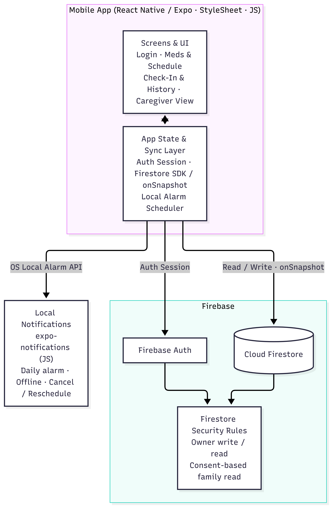

# medication-reminder

A mobile medication adherence app for patients and family caregivers, featuring local reminders, dose history logging, and consent-based real-time sharing.

> Not a medical device; intended as a medication reminder aid and does not provide medical advice.

**Status:** In Progress (Mobile MVP) · **License:** [MIT](./LICENSE)

## Overview

Patients on recurring daily medications often miss doses or take them late, while remote family caregivers lack a clear, consent-based way to check adherence. This mobile app pairs simple on-device reminders and logging with live, permission-controlled caregiver visibility.

One account works for both sides: you track your own medications, and you can also be linked as a read-only caregiver for someone else, or let someone watch yours.

## Core Features

1. **Login:** Sign in via Firebase Authentication.
2. **Medication & Schedule Setup:** Register medications (name, dosage, instructions, prescribing doctor) and daily schedule times.
3. **One-Tap Check-In & History:** Log doses with one tap, edit actual intake time and notes, and review past intake history.
4. **Local Scheduled Reminders:** Schedule recurring on-device notifications for daily dose times.
5. **Consent-Based Caregiver Sync:** Link or revoke family caregivers by consent and sync a read-only adherence view in real time.
6. **Account & Safety:** In-app account deletion, first-run medical disclaimer, and privacy consent.

## Tech Stack

- **Mobile App:** React Native (Expo) / StyleSheet (JS)
- **Authentication:** Firebase Auth
- **Database & Real-Time Sync:** Cloud Firestore
- **Access Control:** Firestore Security Rules
- **Server Logic:** Cloud Functions for Firebase (invite codes, caregiver linking, account deletion)
- **Local Notifications:** Expo-notifications (JS)
- **Build & Release:** EAS Build / EAS Submit

## Architecture



## Getting Started

```bash
git clone https://github.com/jisunpark28/medication-reminder.git
cd medication-reminder
npm install
cp .env.example .env      # fill in your Firebase web app config
npx expo start
```

Never commit .env files or service account keys.
Configure Firebase credentials in your local environment before running the app.

## Documentation

| Document | Summary |
| :--- | :--- |
| [docs/01-requirements.md](./docs/01-requirements.md) | Positioning, target users, scope, and non-functional requirements|
| [docs/02-use-cases.md](./docs/02-use-cases.md) | Use cases UC-01 to UC-06 |


## AI Usage

AI tools were used as a coding and documentation assistant. Architecture, data structure, access control decisions, and final implementation verification were handled directly.
