# UX Flow & UI Wireframes

**Project:** medication-reminder  
**Target Platform:** Android (Expo / React Native + SQLite — Local-First MVP v1.0)  
**Design Tool:** [Figma — Medication Reminder Wireframes (v1.0)](https://www.figma.com/design/oJ373Yu9cr2wfTjhQWRjCd/Medication-Reminder-%E2%80%94-Wireframes--v1.0-?node-id=0-1) (`390×844` mobile frames)  
**Status:** Completed (Phase 1 — Stage 2)

---

## 1. Purpose & Design Principles

- **Purpose:** Translate [01-prd.md](./01-prd.md) into concrete screens, state rules, interactions, and Figma components shared across design and Expo/SQLite implementation.
- **Visual Style:** Clean airy canvas (`#FFFFFF` / `#F8FAFC`) with soft pastel teal (`#2A9D8F` / `#E6F7F5`), rounded cards, and matte polymer-clay 3D pill/tray mascots.
- **Accessibility:** Minimum `48dp × 48dp` touch targets, text + icon labels on all tabs, explicit text status badges (never color or motion alone), and full `Reduce Motion` fallback (no shaking or pop animations).
- **Local-First Trust:** All v1.0 schedules and logs stay on-device in SQLite with no sign-up required.

---

## 2. Design Tokens

| Category | Specification | Usage |
| :--- | :--- | :--- |
| **Background** | `#FFFFFF` (Canvas) · `#F8FAFC` (Card/Section) | Screens, trays, grouped lists |
| **Primary Accent** | `#2A9D8F` (Pastel Teal) · `#1E7E73` (Pressed/Text) | Primary CTA, active tab, selected slot |
| **Tint & Trust Bar** | `#E6F7F5` (Teal Tint) · `#ECFDF5` / `#047857` (Trust) | `Due Now` pill, active tab pill, local-only bar |
| **Status Semantic** | All Done/Taken: `#2E9E6B` (`#EAF8F1`) · Overdue: `#D9822B` (`#FEF5E7`) · Skipped: `#7C8B9E` (DoseLogItem badge only) · Destructive: `#DC2626` | Top header status pills, log item badges, delete action |
| **Borders & Text** | `#E2E8F0` (`1px`) · `#0F172A` / `#64748B` / `#94A3B8` | Dividers, primary/secondary/muted text |
| **Radius & Type** | Card `16px` · Button `12px` · Sheet Top `24px` · Title `20sp` · Body `16sp` · Caption `13sp` | Consistent rounded hierarchy |

---

## 3. End-to-End User Flow

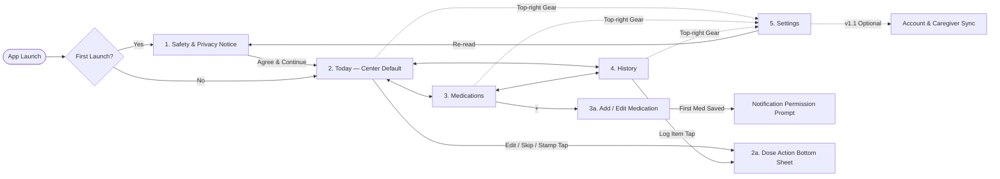

---

## 4. Global Navigation & Chrome

### Bottom Tab Bar (`BottomTabBar`)
- **3 tabs (left → right):** `Medications` — **`Today`** (center, default launch tab) — `History`.
- **Labels:** Icon + text label on all 3 tabs. No 4th tab.
- **Active Tab Highlight:** The active tab uses a `#E6F7F5` rounded pill background with `#2A9D8F` icon and label; inactive tabs use `#64748B` with no background fill.
- **Center `Today` Icon States:**
  - `On Track` / `All Done` / inactive on other tabs: Default capsule mascot (`app_icon.png`).
  - `Due Now`: Waving capsule mascot (`capsule.png`) waves for `1.5–2s` (2–3 cycles), then holds a static raised-hand pose (`Reduce Motion` ON → static raised hand only).
  - `Overdue`: Static raised-hand pose (no extra animation).

### Top Bar & Undo Snackbar
- **Settings (`⚙️`):** Fixed top-right (`≥48dp`) on all 3 tabs.
- **Undo Snackbar (`UndoSnackbar`):** Shown above the tab bar for `3–4s`:
  - Single check-in: `Taken at 8:05 AM · Edit time · Undo`
  - Group check-in (`Log all as taken`): `2 doses taken at 8:05 AM · Undo` (completes only pending items; Undo reverts only the newly completed items).

```text
+-------------------------------------------------------+
| [Title / Back]               [Status Pill]       [⚙️] |
+-------------------------------------------------------+
|                     Screen Body                       |
+-------------------------------------------------------+
| [Taken at 8:05 AM · Edit time · Undo]   (conditional) |
+-------------------------------------------------------+
| [Medications]    [ ● Today (Active) ]     [History]   |
+-------------------------------------------------------+
```

---

## 5. Screen-by-Screen Wireframes & Rules

### 5.1 Onboarding — Safety & Privacy Notice
- **Gate:** Full-screen on first launch; blocks main tabs until `Agree & Continue` is tapped.
- **Layout:** Top 3D mascot (`app_icon.png`) → bold headline → 2 short blocks (non-medical disclaimer + local SQLite privacy) → `Privacy Policy` link → single `Agree & Continue` button → bottom green trust bar (`Stored locally on this device`).
- **Next:** Routes straight to `Today` empty state (`+ Add Medication`). Notification permission, battery guidance, and caregiver sharing are never asked here.

### 5.2 Today (Center Tab — Main Hub)
- **Header:** Centered status text/pill + top-right `⚙️`; date caption (`Thu, Nov 26`) below.
- **Conditional 1-Line Banner:** Shown only if notifications are off (`Notifications are off · Turn on`) or a dose is overdue (with `missed_pill.png`).
- **4 Status States:**

| State | Top Center Header (Color + Text) | Center Tab Icon | Body Behavior |
| :--- | :--- | :--- | :--- |
| **Default** | `#2A9D8F` · `On Track` (`Today` if empty) | Default (`app_icon.png`) | Upcoming slots or empty state (`Add your first medication`) |
| **Due** | `#1E7E73` on `#E6F7F5` · `Due Now` | 1.5–2s wave → static raised hand (`capsule.png`) | Active pill highlighted for 1-tap `Take` |
| **Overdue** | `#D9822B` on `#FEF5E7` · `Overdue` | Static raised hand (`capsule.png`, no motion) | `Overdue` badge on card + amber banner; 1-tap `Take` open until midnight |
| **All Done** | `#2E9E6B` on `#EAF8F1` · `All Done` | Default (`app_icon.png`) | `all_done_celebration.png` + `All doses taken today` (resets at 00:00) |

- **Time Windows (v1.0 fixed):** `Due Now` = scheduled time to `+60 min`; `Overdue` = `+60 min` to `23:59`.
- **Grouping (`DailyDoseCompartments`):** Grouped by exact scheduled time (`08:00`, `13:00`, `20:00`) with a period sub-label (`08:00 · Morning`). Groups with 2+ doses show `Log all as taken` (pending items only).
- **1-Tap Check-In:** Tapping a pill immediately saves `Taken` (current time), plays sparkle + check stamp animation (`check_stamps.png`), and shows `UndoSnackbar`. `Skip`, time edits, and notes open `DoseActionBottomSheet` via `⋯` or tapping a completed item.

### 5.3 Dose Action Bottom Sheet (Shared: `Today` & `History`)
- Drag handle → medication name & scheduled time → **`Taken / Skipped` 2-segment status toggle** → actual intake time picker (default: now) → short note input → `Cancel` (outline) / `Save` (filled).

### 5.4 Medications (Left Tab)
- **Header:** `Medications` + top-right rounded `+` button + `⚙️`.
- **Empty State:** Mascot + `No medications added yet` + 1-line helper + large `+ Add Medication` button.
- **List Cards:** Form icon (`tablet.png`, `capsule.png`, `syrup.png`, `pill_set.png`, `sachet.png`, `pen_injector.png`), name, dosage, daily reminder times, active/paused toggle.
- **Add / Edit Form:**
  - *Required:* Name, 1+ daily reminder times.
  - *Optional:* Form (`Tablet` / `Capsule` / `Syrup` / `Bundle` / `Sachet` / `Pen` — 2 rows of 3 chips), dosage, instructions, prescriber (text).
  - *Save:* Persists to SQLite and schedules/reschedules local notifications; after the first medication is saved, prompts for `POST_NOTIFICATIONS` (with `Not Now`).
  - *Edit & Delete:* Edit screen pre-fills existing fields with `Save Changes` and a destructive `Delete Medication` button (`#DC2626`) → confirmation dialog → cancels future alarms while preserving past dose history.

### 5.5 History (Right Tab)
- **Header:** `History` + `⚙️`.
- **Empty State:** Mascot + `No dose history yet` + 1-line helper.
- **Weekly Bar (`WeeklyPillTray`):** `< Oct 25 – Oct 31 >` navigator (future `>` disabled; past `<` capped at the week of the earliest local record) + `Mon`–`Sun` completion indicators. Tapping a day loads that day's logs.
- **Daily Log List:** `Scheduled time · Medication name` (e.g., `08:00 · Lisinopril`), actual taken time, text badge (`Taken` / `Skipped` / `Missed`), note preview. Tapping any row opens `DoseActionBottomSheet` for late logging, time edits, notes, or toggling `Taken / Skipped`.

### 5.6 Settings (Top-Right `⚙️`)
- **Header:** Back `<` + `Settings`.
- **Grouped Single-Column List:**
  - **Notifications & Reliability:** Notification permission status/request · `Reminders not firing?` (Android battery optimization guide)
  - **Display & Accessibility:** `Reduce Motion` toggle (synced with OS setting)
  - **Safety & Legal:** `Safety & Privacy Notice` (single canonical re-read path) · `Privacy Policy` (external URL)
  - **v1.1 Placeholder (1 row):** `Account & Caregiver Sync (Coming in v1.1)` with `family_care.png`
- **Footer:** Muted version label (`v1.0.0`).

---

## 6. Wireframe Previews (`docs/wireframes_v1.0/`)

### Onboarding & Today

| 01. Onboarding | 02. Today (Empty) | 03. Today (On Track) |
| :---: | :---: | :---: |
| 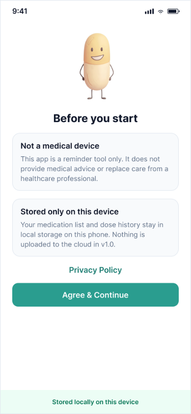 |  | 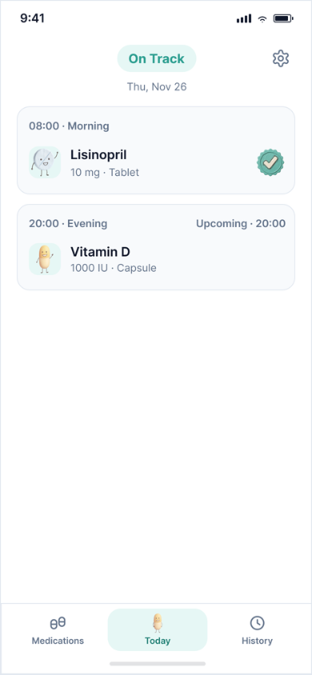 |

| 04. Today (Due Now) | 05. Today (Overdue) | 06. Today (All Done) |
| :---: | :---: | :---: |
| 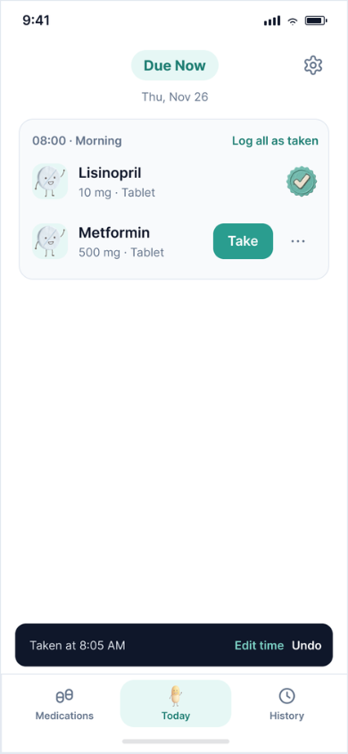 | 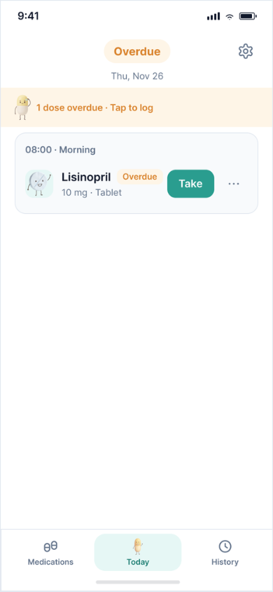 | 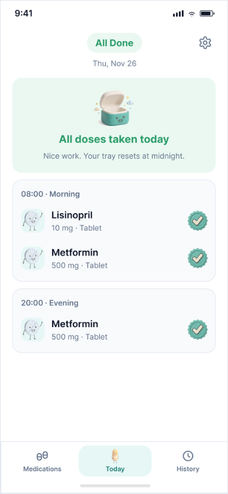 |

| 07. Dose Action Bottom Sheet | | |
| :---: | :---: | :---: |
| 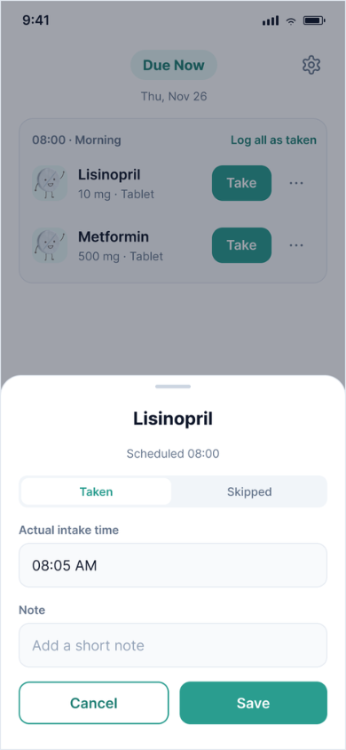 | | |

### Medications

| 08. Medications (Empty) | 09. Medications (List) | 10. Add Medication |
| :---: | :---: | :---: |
|  | 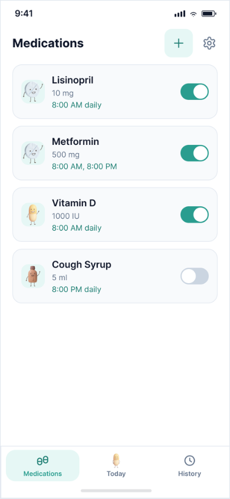 | 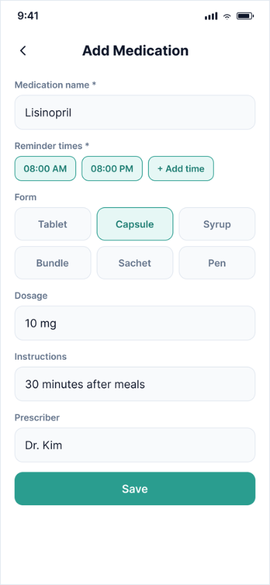 |

| 11. Edit Medication | | |
| :---: | :---: | :---: |
| 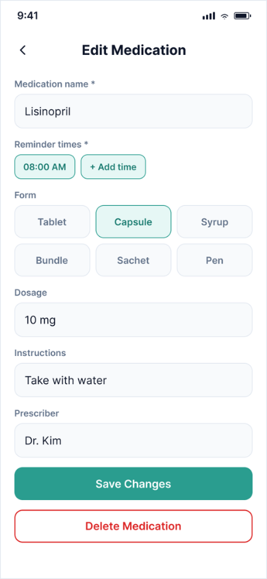 | | |

### History & Settings

| 12. History (Empty) | 13. History (Weekly + Daily Log) | 14. Settings |
| :---: | :---: | :---: |
| 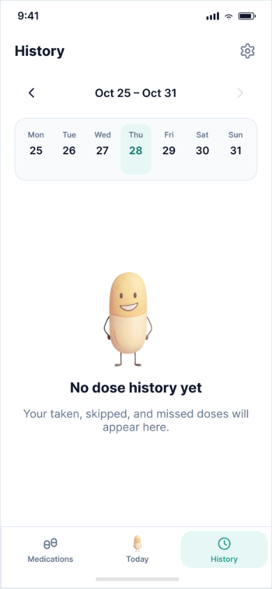 | 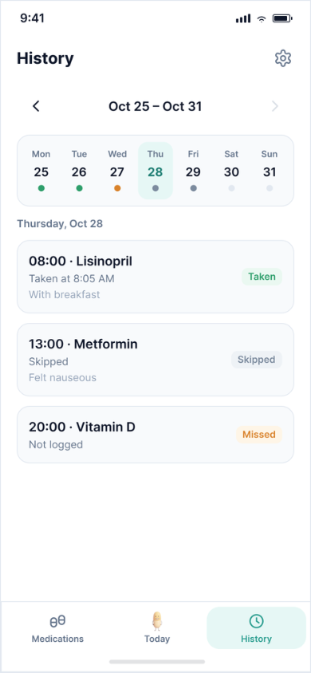 |  |

---

## 7. Asset Mapping (`assets/`)

| Screen / State | UI Slot | File | Status |
| :--- | :--- | :--- | :--- |
| Global / Onboarding / Empty | App icon & default mascot | `app_icon.png` | Ready |
| Meds / Today | Capsule / Tablet / Syrup | `capsule.png`, `tablet.png`, `syrup.png` | Ready |
| Meds / Today | Bundle / Sachet / Pen | `pill_set.png`, `sachet.png`, `pen_injector.png` | Ready |
| Today / History | Weekly tray (open / closed) | `tray_weekly_today_open.png`, `tray_weekly_closed.png` | Ready |
| Today | Daily tray base & glow | `tray_daily_base.png`, `tray_shadow_glow.png` | Ready |
| Today / History | Check-in sparkle & stamp | `particle_sparkle.png`, `check_stamps.png` | Ready |
| Today (`All Done`) | Daily completion graphic | `all_done_celebration.png` | Ready |
| Today (`Overdue`) | Missed/overdue mascot | `missed_pill.png` | Ready |
| Settings / v1.1 Expansion | Caregiver / Streak art | `family_care.png`, `streak_trophy.png` | Ready |

---

## 8. Figma Frame & Component Checklist

- [x] **Frames (`390×844` — 14 total):** `Onboarding`, `Today` (Empty, On Track, Due Now, Overdue, All Done), `DoseActionBottomSheet`, `Medications` (Empty, List, Add, Edit), `History` (Empty, Weekly + Daily Log), `Settings`.
- [x] **Reusable Components:** `BottomTabBar` (`TodayDefault`, `TodayRaised`, `Medications`, `History`), `DoseRow` (`Pending`, `Taken`, `Overdue`), `StatusPill`, `Badge`, `CheckStamp`, `FormIcon`, `Mascot/Capsule`, `UndoSnackbar`.