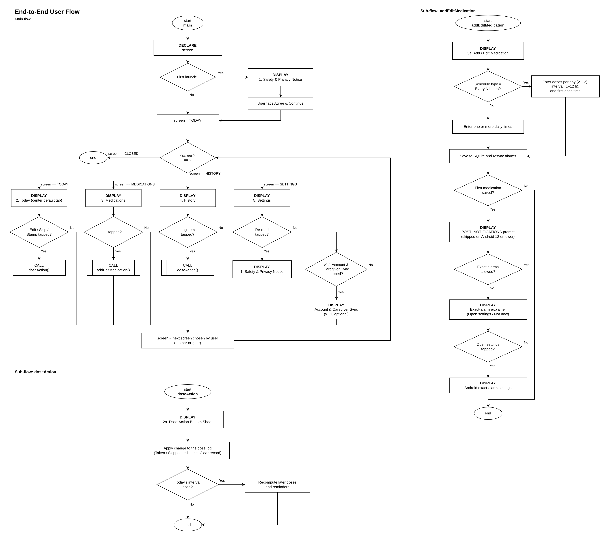
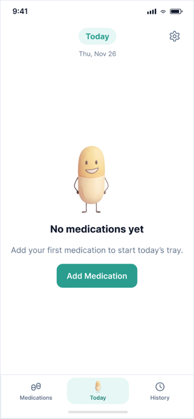
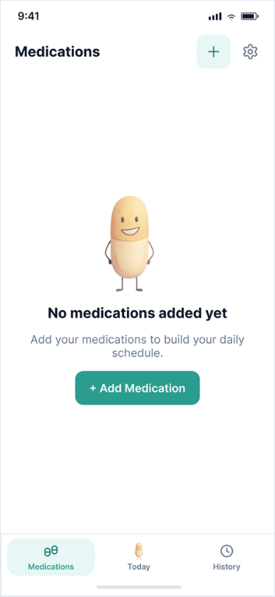
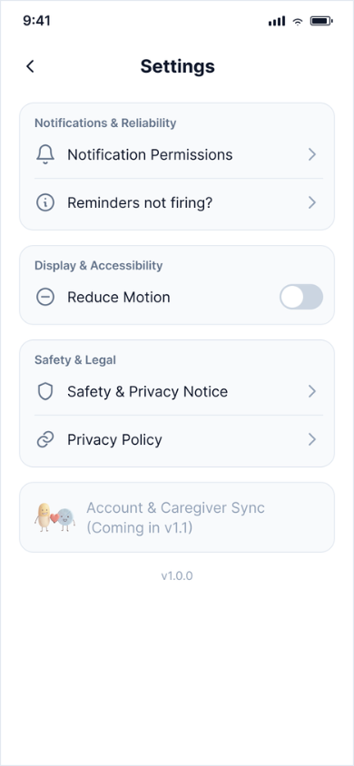

# UX Flow & UI Wireframes

**Project:** medication-reminder  
**Target Platform:** Android (Expo / React Native + SQLite - Local-First MVP v1.0)  
**Design Tool:** [Figma - Medication Reminder Wireframes (v1.0)](https://www.figma.com/design/oJ373Yu9cr2wfTjhQWRjCd/Medication-Reminder-%E2%80%94-Wireframes--v1.0-?node-id=0-1) (390×844 mobile frames)  
**Status:** Text spec updated (Phase 1 - Stage 2). Figma frames pending sync after the Phase 2 notification spike (permission flow screens will be added then). Frames 10/11 show fixed times only; the interval-dosing form is added in the same Figma pass.

---

## 1. Design Principles

- **Visual Style:** Airy canvas, pastel teal, rounded cards, and polymer-clay 3D mascots (tokens below).
- **Accessibility:** 48dp minimum touch targets; text + icon labels on every tab; status never relies on color or motion alone; full Reduce Motion fallback; layout verified at system fontScale 200%. TalkBack: every control and status badge has accessibilityLabel and accessibilityRole; reading order follows visual order (header → banner → dose groups → tab bar).
- **Local-First:** v1.0 schedules and logs stay on-device in SQLite with no sign-up.

---

## 2. Design Tokens

| Category             | Specification                                                                                                                     | Usage                                                   |
| :------------------- | :-------------------------------------------------------------------------------------------------------------------------------- | :------------------------------------------------------ |
| **Background**       | #FFFFFF (Canvas) · #F8FAFC (Card/Section)                                                                                         | Screens, trays, grouped lists                           |
| **Primary Accent**   | #2A9D8F (Pastel Teal) · #1E7E73 (Pressed/Text)                                                                                    | Primary CTA, active tab, selected slot                  |
| **Tint & Trust Bar** | #E6F7F5 (Teal Tint) · #ECFDF5 / #047857 (Trust)                                                                                   | Due Now pill, active tab pill, local-only bar           |
| **Status Semantic**  | All Done/Taken: #2E9E6B (#EAF8F1) · Overdue / Missed: #D9822B (#FEF5E7) · Skipped: #7C8B9E (DoseLogItem badge only) · Destructive: #DC2626 | Top header status pills, log item badges, delete action |
| **Borders & Text**   | #E2E8F0 (1px) · #0F172A / #64748B / #94A3B8                                                                                       | Dividers, primary/secondary/muted text                  |
| **Radius & Type**    | Card 16px · Button 12px · Sheet Top 24px · Title 20sp · Body 16sp · Caption 13sp                                                  | Consistent rounded hierarchy                            |

---

## 3. End-to-End User Flow

**Design Tool:** [draw.io - User Flow v1 (open in diagrams.net)](https://app.diagrams.net/#Hjisunpark28/medication-reminder/main/docs/diagrams/user-flow-v1.drawio) · source file: [user-flow-v1.drawio](./diagrams/user-flow-v1.drawio)

---

## 4. Navigation & Shared Interactions

- **Tabs (left → right):** Medications - Today - History
- **Today icon:**
  - Default mascot for On Track, All Done, and when inactive on other tabs.
  - Due Now: 1.5–2s wave (2–3 cycles), then a static raised-hand pose; Reduce Motion uses the static pose only.
  - Overdue: static raised hand, no animation.
- **Settings:** Top-right gear on all three tabs.
- **Undo snackbar:** 6–8s above the tab bar.
  - Single check-in: "Taken at 8:05 AM · Edit time · Undo"
  - Group ("Log all as taken"): "2 doses taken at 8:05 AM · Undo" - completes pending items only; Undo reverts only those new completions.
  - Guidance: "You can also clear today's record in History."

---

## 5. Screen Rules

### 5.1 Onboarding

Never asks for notification permission, battery guidance, or caregiver sharing.

### 5.2 Today

- One banner at most, in order: notifications off, exact alarm not allowed (inexact still scheduled), overdue.
- Due Now = scheduled time to +60 min; Overdue = +60 min to 23:59. Take stays available until midnight.
- All Done = at least one slot and every slot logged. Copy: "All doses logged today". Resets at 00:00.
- Interval doses: later doses show "Pending - after dose N" (Take disabled) until the previous dose is logged. Doses past 23:59 do not appear.
- "Log all as taken" completes pending items only. Take logs the current time and shows the undo snackbar.

### 5.3 Dose Action Bottom Sheet

- Taken → Skipped clears the taken-at time.
- For today's interval doses, any change recomputes later doses and reminders.
- Past dates: only Taken or Skipped (Taken defaults to the scheduled time); no Clear record and no recompute.

### 5.4 Medications

- Required: name and a schedule.
- "Every N hours": doses per day 2–12, interval 1–12 h. Helper: "Enter as prescribed." The app never suggests an interval.
- If later doses would pass 23:59, show "Only N of M doses fit before midnight." Saving stays allowed.
- Changing schedule fields removes today's unlogged doses; logged doses stay.
- Notification permission is skipped on Android 12 or lower; the exact-alarm explainer shows only when exact alarms are not allowed.
- A time already passed today shows "First reminder: tomorrow at HH:mm".
- Delete cancels future alarms and keeps past history.

### 5.5 History

Week navigator: no future weeks; past capped at the earliest record's week.

### 5.6 Settings

- "Reminders not firing?" guide; lock-screen medication name OFF by default.
- Reduce Motion synced with the OS.
- Local-only note: v1.0 data does not transfer when switching phones.

---

## 6. Wireframe Previews

### Onboarding & Today

|                                01. Onboarding                                |                       02. Today (Empty)                        |                       03. Today (On Track)                        |
| :--------------------------------------------------------------------------: | :------------------------------------------------------------: | :---------------------------------------------------------------: |
|  |  |  |

|                       04. Today (Due Now)                        |                       05. Today (Overdue)                        |                       06. Today (All Done)                        |
| :--------------------------------------------------------------: | :--------------------------------------------------------------: | :---------------------------------------------------------------: |
|  |  |  |

|                        07. Dose Action Bottom Sheet                        |     |     |
| :------------------------------------------------------------------------: | :-: | :-: |
|  |     |     |

### Medications

|                       08. Medications (Empty)                        |                       09. Medications (List)                        |                           10. Add Medication                            |
| :------------------------------------------------------------------: | :-----------------------------------------------------------------: | :---------------------------------------------------------------------: |
|  |  |  |

|                           11. Edit Medication                            |     |     |
| :----------------------------------------------------------------------: | :-: | :-: |
|  |     |     |

### History & Settings

|                       12. History (Empty)                        |                      13. History (Weekly + Daily Log)                       |                        14. Settings                         |
| :--------------------------------------------------------------: | :-------------------------------------------------------------------------: | :---------------------------------------------------------: |
|  |  |  |

---

## 7. Asset Mapping

| Screen / State              | UI Slot                     | File                                                   | Status |
| :-------------------------- | :-------------------------- | :----------------------------------------------------- | :----- |
| Global / Onboarding / Empty | App icon & default mascot   | `app_icon.png`                                         | Ready  |
| Meds / Today                | Capsule / Tablet / Syrup    | `capsule.png`, `tablet.png`, `syrup.png`               | Ready  |
| Meds / Today                | Bundle / Sachet / Pen       | `pill_set.png`, `sachet.png`, `pen_injector.png`       | Ready  |
| Today / History             | Weekly tray (open / closed) | `tray_weekly_today_open.png`, `tray_weekly_closed.png` | Ready  |
| Today                       | Daily tray base & glow      | `tray_daily_base.png`, `tray_shadow_glow.png`          | Ready  |
| Today / History             | Check-in sparkle & stamp    | `particle_sparkle.png`, `check_stamps.png`             | Ready  |
| Today (All Done)            | Daily completion graphic    | `all_done_celebration.png`                             | Ready  |
| Today (Overdue)             | Missed/overdue mascot       | `missed_pill.png`                                      | Ready  |
| Settings / v1.1 Expansion   | Caregiver / Streak art      | `family_care.png`, `streak_trophy.png`                 | Ready  |

---
