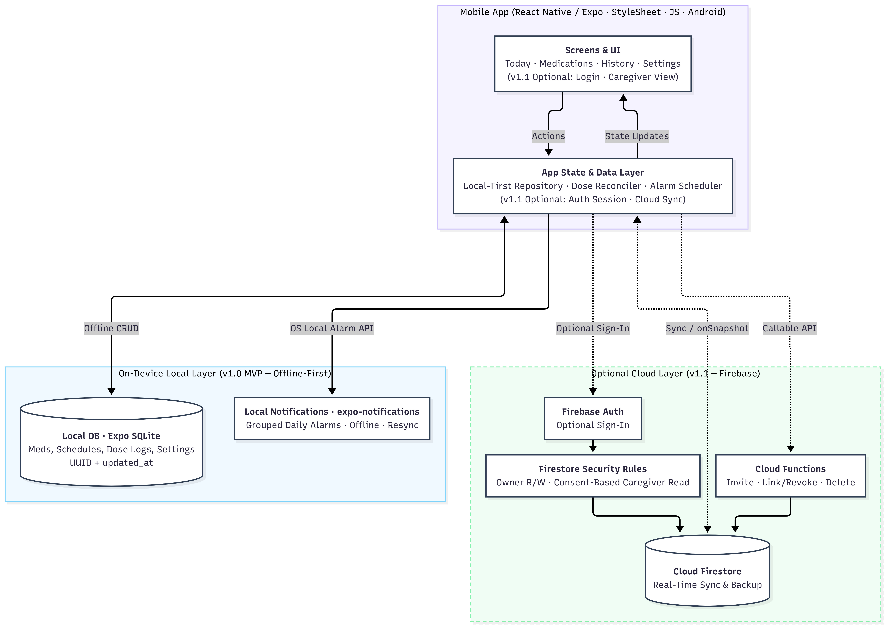
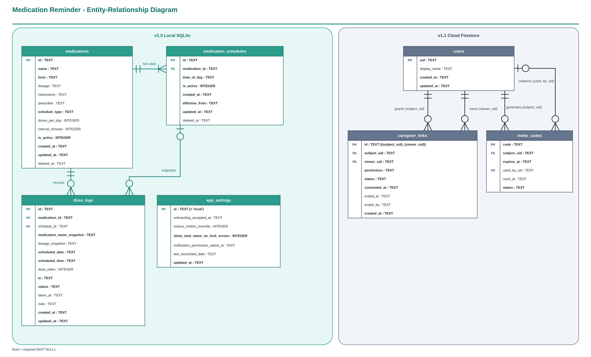

# System Architecture & Entity-Relationship Diagram (ERD)

**Project:** medication-reminder  
**Target Platform:** Android (Expo / React Native + Expo SQLite + Expo Notifications - v1.0)  
**Cloud Expansion:** Firebase Auth + Cloud Firestore + Cloud Functions (v1.1 Optional)  
**Status:** Text spec complete; notification design gated by Phase 2 spike (Phase 1 - Stage 3)

---

## 1. Architecture Overview (Local-First v1.0 → Cloud Sync v1.1)

v1.0 is offline-first: all core features run with zero network and sub-200ms SQLite reads. Every record uses a client-generated UUID and a UTC `updated_at` (`YYYY-MM-DDTHH:mm:ss.SSSZ`) so v1.1 cloud sync can layer on without a schema break.

### 1.1 Notification Reliability & Privacy

| Topic                       | Rule                                                                                                                                                                                                                                                                          |
| :-------------------------- | :---------------------------------------------------------------------------------------------------------------------------------------------------------------------------------------------------------------------------------------------------------------------------- |
| **Exact alarms & fallback** | Uses SCHEDULE_EXACT_ALARM; shows an explainer only when not allowed, falls back to inexact alarms with a Today banner, and prepares Play Console justification.                                                                                                               |
| **Phase 2 spike (gate)**    | Verifies AlarmManager APIs (JS vs native module), exact one-shot notifications, 7-day no-launch/reboot reliability (14-day rolling fallback), and minSdk across Android 12 or lower / 13 / 14+.                                                                               |
| **Sync engine**             | resyncAll() groups v_active_schedules into dose-HH:mm notifications (fixed times + interval dose 1), adds one-shots for today's interval doses 2+, set once the previous dose is logged (dose-{medicationId}-{date}-{index}), diffs (id, time, body, channel), and retries on launch/resume without rolling back SQLite. |
| **Privacy & limits**        | Lock-screen shows generic text by default (body-only toggle, never switches channels); allowBackup=false; closed-app revocation/force-stop noted in Settings.                                                                                                                 |
| **Midnight refresh**        | Midnight timer or AppState change refreshes Today and runs reconciliation if the app stays open past midnight.                                                                                                                                                                |

### 1.2 Today Slots, Reconciliation & Guards

| Topic                   | Rule                                                                                                                                                                                                                                                                                                                                                                                                                                       |
| :---------------------- | :----------------------------------------------------------------------------------------------------------------------------------------------------------------------------------------------------------------------------------------------------------------------------------------------------------------------------------------------------------------------------------------------------------------------------------------- |
| **Today & All Done**    | Union of eligible slots and today's dose_logs, deduped per slot (fixed: medication + time; interval: medication + dose index), log wins using snapshots. All Done = 1+ slots, all logged.                                                                                                                                                                                                                                                  |
| **Interval dosing**     | One schedule row anchors dose 1. Dose k+1 is due at dose k's taken_at + interval, or its due time + interval if skipped/missed, in absolute instants; it shows "Pending - after dose k" until dose k is logged. Due times after 23:59 are dropped (no slot, no missed). Undo, clear, status, or time edits on dose k recompute today's later doses and their one-shots.                                                                            |
| **Effective-From Rule** | Eligibility uses slotInstant >= schedule.effective_from (not date-only) for both Today and reconciliation; updated on create and resume.                                                                                                                                                                                                                                                                                                   |
| **Same-day changes**    | Pause, delete, or a time change (including schedule type, doses per day, interval, or anchor) drops today's unlogged slots and keeps existing logs; name/dosage edits keep slots.                                                                                                                                                                                                                                                          |
| **Reconciliation**      | Scans (last_reconciled_date, yesterday] idempotently (transaction + INSERT OR IGNORE on the slot key), initializes NULL to yesterday without backfill, and runs before any mutation. Past interval days replay the chain: logged doses keep their times, unlogged ones chain from the previous dose (anchor + (k-1) × interval if none logged), and missed is inserted only up to 23:59 and only if dose 1 passes the Effective-From Rule. |
| **DST & testability**   | Spring-forward gaps shift forward; fall-back picks the first occurrence. Soft deletes protect history; Clock injection enables fake-clock tests (DST, pause/resume, and interval cases: late dose 1 shifts dose 2, skipped dose 2 chains from its due time, dose past midnight dropped, undoing dose 1 cancels dose 2's one-shot, interval across 2027-03-14).                                                                             |

---

## 2. Entity-Relationship Diagram (Crow's Foot Notation)

**Design Tool:** [draw.io - ERD v1 (open in diagrams.net)](https://app.diagrams.net/#Hjisunpark28/medication-reminder/main/docs/diagrams/erd-v1.drawio) · source file: [erd-v1.drawio](./diagrams/erd-v1.drawio)

---

## 3. Local SQLite Schema, Constraints & Migrations (v1.0)

Full DDL (tables, indexes, seed, and v_active_schedules view): **[schema-v1.sql](./schema-v1.sql)**

- **Migrations:** Run PRAGMA foreign_keys = ON before the migration transaction.
- **effective_from:** Set to now on resume, with all active child schedules in the same transaction.
- **Interval anchor:** An interval medication has exactly one active schedule row (enforced in app code).
- **Dose identity:** Interval doses are keyed by dose_index, not time, because computed times can move.
- **Active view:** Today, DoseReconciler, and resyncAll() all read v_active_schedules.

---

## 4. v1.0 → v1.1 Cloud Firestore Mapping & Security Design

| Local SQLite (v1.0)    | Cloud Firestore Path (v1.1)                  | Notes                                                                                                                                             |
| :--------------------- | :------------------------------------------- | :------------------------------------------------------------------------------------------------------------------------------------------------ |
| `medications`          | `users/{uid}/medications/{medicationId}`     | Medication document only; schedules are not embedded                                                                                              |
| `medication_schedules` | `users/{uid}/schedules/{scheduleId}`         | Dedicated subcollection so merge granularity matches UUID union; soft-deleted schedules stay addressable and do not break `dose_logs.schedule_id` |
| `dose_logs`            | `users/{uid}/dose_logs/{logId}`              | Same UUID doc ID; includes `tz` so caregivers see the patient's local day                                                                         |
| - (v1.1 only)          | `caregiver_links/{subject_uid}_{viewer_uid}` | Deterministic doc ID, created only by Cloud Functions; enables O(1) `exists()` rules                                                              |
| - (v1.1 only)          | `invite_codes/{code}`                        | Crypto-random single-use code with short TTL and rate-limited redemption                                                                          |

### Sync & Security Guarantees (v1.1)

- **Access & validation:** Owner-only writes under users/{uid}/\*\* with field, type, and length checks; caregivers get read-only access only through an active caregiver_links document.
- **Link & account lifecycle:** Invite codes, link creation/ending (either side), reconnect, and account deletion run exclusively through Cloud Functions; email stays in Firebase Auth.
- **Multi-device merge:** First sign-in merges local and cloud records by UUID union at document granularity using updated_at and serverTimestamp().
- **Deletions:** v1.0 hard-deletes today's dose_logs on Undo/Clear; v1.1 needs deleted_at or sync_outbox so clears are not restored from the cloud.
